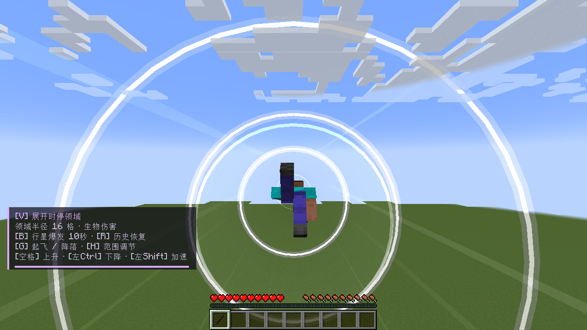

# Shadow Atomic · 影之实力者风格模组

版本：0.33.2-alpha（Alpha 测试版）
环境：Minecraft Java 1.20.1 + Forge 47.x + Java 17
实测环境：Forge 47.4.13；玩家包声明最低 Forge 47.1。

## 安装

1. 安装 Minecraft 1.20.1 对应的 Forge。
2. 解压本包，把 `shadow-atomic-0.33.2-alpha.jar` 放入你正在使用的游戏实例的 `mods` 文件夹。
3. 如果已装旧版 Shadow Atomic，先退出游戏并移除旧 JAR，只保留一个版本。
4. 用 Forge 配置启动。这个包提供 Mod 文件，需要自行准备游戏和 Forge。
5. 首次进入世界自动赠送暗影之剑；主手或副手持剑启用能力。

联机时服务端和客户端均安装同一版本。单人集成世界已验证，真实多人及外部光影兼容性尚未实测。

## 功能与默认按键

模组按键可在「选项 → 控制 → 按键绑定」中修改。下列为默认模组按键；疾跑和潜行跟随 Minecraft 自身的绑定。

| 按键 | 功能 |
| --- | --- |
| V | 展开时停领域，再按释放 Atomic |
| B | 瞄准生物释放行星爆发 |
| R | 打开 Recovery 历史，选择恢复记录 |
| G / 双击空格 | 开启或关闭飞行 |
| 疾跑键 + WASD | 飞行中逐渐加速，松开疾跑键减速 |
| 空格 / 潜行键 | 飞行中上升 / 下降 |
| H | 剑身检视，调节技能与恢复范围、剑攻击值 |
| J | 切换技能演出镜头 |
| O | 切换低闪光模式 |
| K | 切换特效画质 |
| 左键 / 右键 | 普通挥剑攻击 / 格挡 |

原版默认疾跑是左 Ctrl，潜行是左 Shift；如果你重绑过，飞行加速与下降也跟随你的设置。
如果起飞前已经按住疾跑键，先松开再按才能加速；只按疾跑键而不按方向不会自动前冲。
高速飞行时显示连续白紫马赫环、气流和扩散音障环。普通悬停不显示超音速环。

## 本版更新

- 恢复身边连续展开的三道白紫马赫环，高速时更容易看见。
- 飞行控制沿用0.33.1：双击空格普通起飞，疾跑键主动加速，WASD和转向可控，松键减速。
- 左键保持普通挥剑，第一、第二技能默认伤害10000，并保留末影龙部件命中处理。
- 保留时停领域、Recovery事件恢复、原有技能演出与声音。

默认玩法包含真实伤害与地形破坏。首次体验建议在新建测试世界使用；恢复作用于模组已记录的事件与选定范围。
持剑使用 `/atomic preview` 可以演示预览；服务器配置位于世界 `serverconfig/shadow_atomic-server.toml`。

## 下载与源码

安装包位于本仓库 Releases。需要游玩的玩家下载发布压缩包或玩家 JAR；本仓库提供源码，构建方法见 [BUILDING.md](BUILDING.md)。

## 实机截图

## 验证与来源

本版构建及86项隔离游戏内检查通过，报告见 [docs/verification/report.json](docs/verification/report.json)。已查看的截图记录见 [visual-review.json](docs/verification/visual-review.json)。

素材与音频来源见 [ASSET_SOURCES.md](ASSET_SOURCES.md)、[AUDIO_SOURCES.md](AUDIO_SOURCES.md)。当前许可声明为 All Rights Reserved，详情见 [许可与素材说明.md](许可与素材说明.md)。
